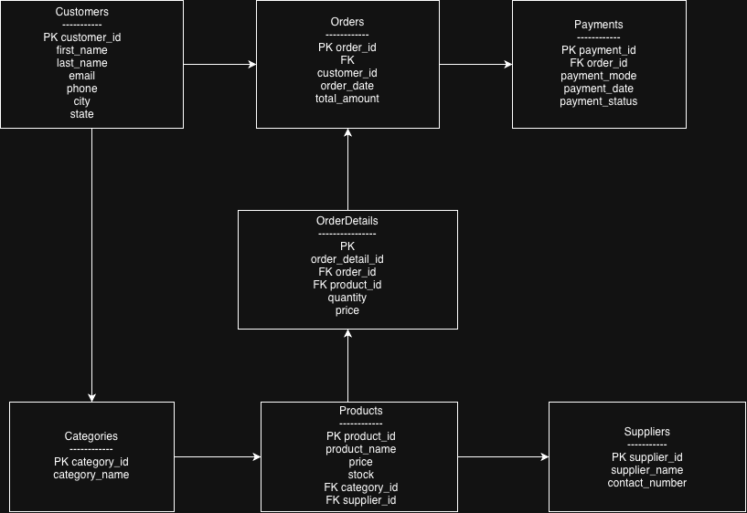

# 🛒 Online Retail Management System (MySQL)

## Project Overview

The Online Retail Management System is a relational database project developed using MySQL. It simulates the backend database of an online shopping platform by managing customers, products, suppliers, orders, payments, and order details.

This project demonstrates practical SQL concepts including relational database design, foreign keys, joins, aggregate functions, grouping, filtering, and data retrieval.

---

## Technologies Used

- MySQL
- SQL
- VS Code
- Git & GitHub

---

## 📂 Database Tables

- Customers
- Categories
- Suppliers
- Products
- Orders
- OrderDetails
- Payments

---

## ✨ Features

- Customer Management
- Product Inventory
- Order Management
- Payment Tracking
- Product Categorization
- Supplier Management

---

## 📊 SQL Concepts Implemented

- SELECT
- WHERE
- ORDER BY
- GROUP BY
- HAVING
- INNER JOIN
- LEFT JOIN
- RIGHT JOIN
- Aggregate Functions
- Subqueries

---

## Project Structure

```text
ONLINE-RETAIL/
│
├── images/
│      ER_Diagram.png
│
├── schema.sql
├── sample_data.sql
├── queries.sql
└── README.md
```

---

## ER Diagram



---


##  How to Run

1. Open MySQL Workbench.
2. Execute `schema.sql`.
3. Execute `sample_data.sql`.
4. Run queries from `queries.sql`.

---

## 📷 Sample Output

The project supports:
- Product Listing
- Customer Orders
- Payment Details
- Sales Analysis
- Inventory Queries

---

##  Author

**Siya Kumari**

B.Tech CSE (AI)

Galgotias University

